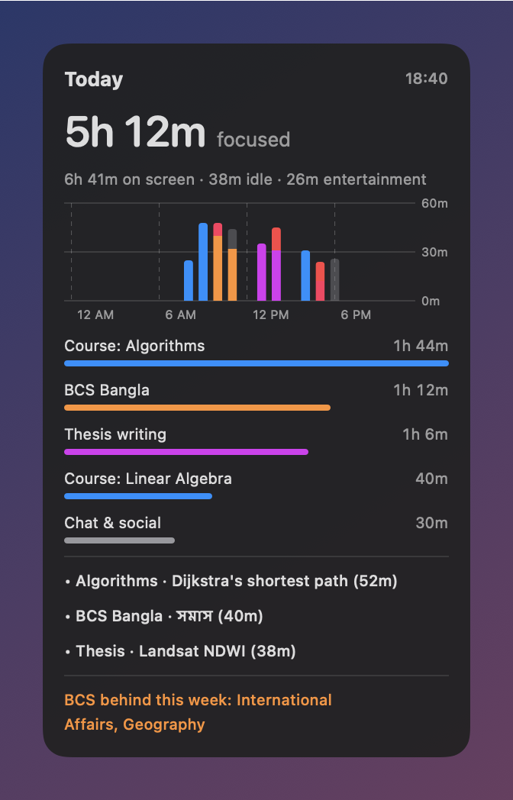

# StudyLens

**Know where your study time actually goes, without sending your screen anywhere.**

StudyLens is a tiny Mac app that notices what you are studying, labels it with an AI model that runs
entirely on your Mac, and shows a desktop widget with today's focused time, your top subjects and what
you actually learned. Tell it your courses or exam subjects in your own words; it builds the categories.

<p align="center"></p>

- 🔒 **Local-first.** Screenshots go only to [Ollama](https://ollama.com) on your own Mac and are deleted right after labeling. No account, no server, no analytics.
- 🧠 **Understands content, not just apps.** A YouTube lecture on eigenvalues counts as Linear Algebra; a YouTube music video does not.
- 🗣️ **You describe, it organises.** `studylens setup` turns "CSE undergrad, Algorithms and Linear Algebra, preparing for BCS" into categories.
- ⚖️ **Balance check.** Give exam subjects weights (e.g. marks) and the widget tells you which ones are falling behind.
- 📊 **Screen Time-style charts.** Hourly bars for today and daily bars for the week, by subject group, with idle time and entertainment as their own colors.
- ✏️ **Fix a label in one click, and it sticks.** Type or pick the right subject; StudyLens re-labels that time, uses it from then on, and learns from the example. One thing always gets one label.
- 😴 **Honest idle time.** 5 minutes without input counts as idle, unless a video or call is playing.
- 🕶️ **Private windows stay private.** Chrome incognito and Safari private windows are never captured.
- 🖥️ **Multi-monitor aware**, hides the widget at places you choose (e.g. campus), weekend check-in, optional Notion sync.

## Requirements

- Mac with Apple silicon (M1 or newer), macOS 14 Sonoma or newer
- 16 GB memory recommended for the default model, about 7 GB free disk space
- [Homebrew](https://brew.sh) (the installer uses it for Ollama and uv if you don't have them)

## Install

**One line** (recommended):

```bash
curl -fsSL https://raw.githubusercontent.com/zarifbinhasnat/studylens/main/get.sh | bash
```

**Or download** `StudyLens-macOS-arm64.zip` from [Releases](https://github.com/zarifbinhasnat/studylens/releases),
unzip it, then right-click **Install StudyLens.command** → **Open** (StudyLens is not notarized by Apple, so a
normal double-click is blocked the first time).

**Or from source:** `git clone https://github.com/zarifbinhasnat/studylens && cd studylens && ./install.sh`
(needs `xcode-select --install`).

The installer downloads the AI model (`qwen3-vl:8b-instruct`, about 6 GB) once, starts StudyLens, and offers
to run `setup`. When macOS asks, allow **Screen Recording**, **Accessibility** (only for spotting Safari private
windows) and **Chrome/Safari automation** (only for spotting incognito windows).

## Tell it what you study

```bash
~/Library/Application\ Support/StudyLens/bin/studylens setup
```

```text
> 3rd-year CSE student. Courses: Algorithms, Operating Systems, Linear Algebra, Technical Writing.
> Thesis on flood mapping with Sentinel-1 radar. Preparing for IELTS (reading and writing).
>
```

The local model proposes groups and categories with hints for recognising them on screen; you confirm.
Starting from a preset works too, e.g. Bangladesh Civil Service with the 200 preliminary marks as weights:

```bash
~/Library/Application\ Support/StudyLens/bin/studylens setup --preset examples/bcs-preliminary.json
```

Every weekend (Saturday and Sunday evening by default) StudyLens asks what you were doing or learning, and uses
your answer to re-label time it couldn't place.

## Everyday use

**Menu bar (book icon) → Subjects & labels…** opens the app window:

- **Overview**: today by hour or the last 7 days by day, stacked by subject group, with idle and entertainment, plus totals.
- **Recent activity**: everything you did, named by what it was (the page or file title, or the topic of a chat), each with a
  subject box. Pick or type a subject; a new name creates that subject. The choice applies to all of that thing's
  minutes and to every future minute of it, and the topic becomes an example the AI learns from.
- **Subjects**: add, rename or delete subjects and groups, edit how each looks on screen, or describe something new
  and press **Add with AI**.

The menu also has: show/hide the widget, keep it above windows, pause tracking for an hour, weekend check-in, open the
data folder. In the terminal, `studylens report` prints today's summary.

Advanced settings live in `~/Library/Application Support/StudyLens/config.json`:

| Setting | Default | Meaning |
|---|---|---|
| `model` | `qwen3-vl:8b-instruct` | Any Ollama vision model; on 8 GB Macs pick a smaller one from the Ollama library and `ollama pull` it |
| `idle_minutes` | 5 | No input for this long (and no video) counts as idle |
| `screenshot_every_minutes` | 5 | Also captures on every window change |
| `no_screenshot_apps` | WhatsApp, Messages, Passwords… | Bundle IDs never captured |
| `hide_widget_at` | none | `[{"name": "Campus", "lat": 23.8, "lon": 90.4, "radius_m": 600, "ssid_contains": ["CampusWiFi"]}]` |
| `checkin` | Sat & Sun, 20:00 | Weekdays use 1 = Sunday … 7 = Saturday |
| `keep_screenshots` | false | Keep screenshots after labeling (for debugging) |

Restart StudyLens from the menu after editing intervals, apps or places. Categories apply immediately.

## Notion (optional)

1. Create an internal integration at [notion.so/profile/integrations](https://www.notion.so/profile/integrations) and copy its token.
2. Store the token in your Keychain (you'll be asked to paste it; it is never written to a file):
   ```bash
   security add-generic-password -s studylens-notion -a notion -w
   ```
3. Make a page in Notion, open **⋯ → Connections** and add your integration.
4. Create the tables under that page:
   ```bash
   ~/Library/Application\ Support/StudyLens/bin/studylens notion-init "https://www.notion.so/Your-page-…"
   ```

A **Daily** row (hours per group, top subjects, what you studied) updates every 10 minutes, and each weekend
check-in becomes a **Weekly check-ins** row. Add a chart view on Daily to see your focused hours over time.

## How it works

```text
StudyLens.app (Swift, menu bar)          every minute: front app + title, idle/video, private-window check,
        │                                screenshot of the active display on window change / every 5 min
        ▼
studylens.db (SQLite, local)
        ▼
studylens analyze (Python via uv,        every 10 min: Ollama vision model labels each new minute,
 launchd)                                deletes screenshots, writes summary.json, optional Notion sync
        ▼
desktop widget + Notion
```

Minutes in the same window reuse the last label, so the model runs a few times per hour, not every minute.
On battery it labels at most 6 screenshots per run and catches up when you plug in.

## Uninstall

```bash
curl -fsSL https://raw.githubusercontent.com/zarifbinhasnat/studylens/main/uninstall.sh | bash
```

## Limitations

- AI labels can be wrong, especially for vague screens; the weekend check-in and clear file names help.
- Not notarized by Apple (no paid developer account), hence the right-click → Open step for the zip.
- Apple silicon only. Intel Macs are too slow for the vision model.

## Privacy

See [PRIVACY.md](PRIVACY.md). Short version: nothing leaves your Mac unless you turn on Notion sync, and then
only totals and topic names.

## Contributing

Issues and pull requests are welcome. The app is one Swift file (`app/main.swift`) and the analyzer one Python
module (`analyzer/src/studylens/__init__.py`); build with `./install.sh`, package with `scripts/package.sh`.

## License

[MIT](LICENSE) © 2026 Md. Zarif Bin Hasnat
